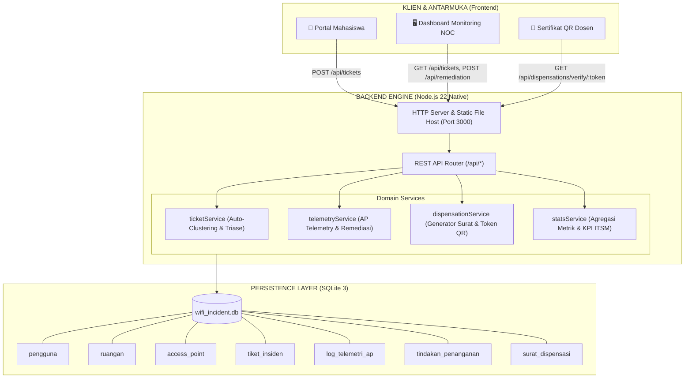

# DOKUMENTASI ARSITEKTUR BACKEND & SPESIFIKASI REST API
## Kasus: Sistem Resolusi Insiden Wi-Fi Tugas Daring Kampus (UPT TIK)

---

## 1. PENDAHULUAN & ARSITEKTUR TEKNOLOGI

Dokumen ini mendokumentasikan implementasi backend, skema basis data nyata, dan spesifikasi REST API untuk **Sistem Resolusi Insiden Wi-Fi Tugas Daring Mahasiswa**. Backend ini merealisasikan kebutuhan fungsional (FR-01 s/d FR-08) dan pemodelan sistem (UML & ERD) yang telah dirancang sebelumnya.

### Karakteristik Arsitektur:
* **Runtime**: Node.js v22+ (ES/CommonJS Engine).
* **Database Engine**: SQLite 3 terintegrasi via driver native `node:sqlite` (*zero external dependencies*, tanpa perlu kompilasi build tools C++).
* **Komunikasi & Antarmuka**: RESTful API berbasis HTTP JSON dengan dukungan penuh *Cross-Origin Resource Sharing* (CORS).
* **Full-Stack Wiring**: Frontend prototipe [`mockup_antarmuka_sistem.html`](mockup_antarmuka_sistem.html) langsung terhubung secara dinamis ke REST API saat server aktif.



---

## 2. STRUKTUR BERKAS DAN MODUL SISTEM

```
ProjectP-ML/
├── database/
│   ├── schema.sql                 # Definisi DDL 7 Tabel & Indeks Performa
│   ├── seed.sql                   # Data awal realistis untuk pengujian
│   ├── init_db.js                 # Script eksekutor inisialisasi basis data
│   └── wifi_incident.db           # File database SQLite (Auto-generated)
├── src/
│   ├── db.js                      # Wrapper koneksi database singleton
│   ├── routes.js                  # Dispatcher endpoint RESTful API
│   └── services/
│       ├── ticketService.js       # Logika tiket & algoritma Auto-Clustering P1
│       ├── telemetryService.js    # Telemetri AP & eksekusi mitigasi beban
│       ├── dispensationService.js # Penerbitan surat resmi & verifikasi token QR
│       └── statsService.js        # Perhitungan ringkasan statistik & metrik KPI
├── tests/
│   └── test_api.js                # Automated End-to-End Test Suite (10 Test Cases)
├── mockup_antarmuka_sistem.html   # Antarmuka web terintegrasi full-stack
├── DESAIN_ANTARMUKA_UI_MOCKUP.md  # Dokumentasi desain UI & wireframe
├── PEMODELAN_SISTEM_UML.md        # Pemodelan UML, BPMN Swimlane, dan ERD
├── WORKFLOW_DAN_KEBUTUHAN_SISTEM.md # Analisis kebutuhan sistem FR/NFR
├── package.json                   # Konfigurasi npm run scripts
├── server.js                      # Entry point server web & REST API
└── CHANGELOG.md                   # Riwayat versi proyek terstruktur
```

---

## 3. SPESIFIKASI ENDPOINT REST API

### A. Layanan Sistem & Master Data

#### 1. Health Check
* **Endpoint**: `GET /api/health`
* **Deskripsi**: Memeriksa ketersediaan server backend dan koneksi database.
* **Respon Contoh (`200 OK`)**:
```json
{
  "status": "UP",
  "service": "UPT TIK Wi-Fi Incident Management API",
  "version": "1.0.0",
  "serverTime": "2026-11-04T01:52:03.000Z"
}
```

#### 2. Daftar Master Ruangan
* **Endpoint**: `GET /api/rooms`
* **Deskripsi**: Menyediakan daftar gedung, lantai, dan ruangan kampus untuk opsi pelaporan mahasiswa.
* **Respon Contoh (`200 OK`)**:
```json
{
  "success": true,
  "count": 6,
  "data": [
    {
      "id_ruangan": "GD-B-LT2-LAB03",
      "nama_gedung": "Gedung B (Fakultas Teknik)",
      "nomor_lantai": 2,
      "nama_ruangan": "Lab Komputer 3",
      "kapasitas_mahasiswa": 40
    }
  ]
}
```

---

### B. Layanan Tiket Gangguan Mahasiswa (FR-01 & FR-02)

#### 3. Buat Laporan Tiket Baru (*Emergency Incident Reporting*)
* **Endpoint**: `POST /api/tickets`
* **Headers**: `Content-Type: application/json`
* **Payload Request**:
```json
{
  "userId": "220101089",
  "namaPelapor": "Ahmad Fauzi",
  "idRuangan": "GD-B-LT2-LAB03",
  "mataKuliah": "Jaringan Komputer Lanjut",
  "dosenPengampu": "Dr. Eng. Wahyu Pratama, M.Kom.",
  "deadlineTugas": "2026-11-04 10:00:00",
  "gejalaGangguan": "Koneksi putus mendadak saat upload tugas di LMS",
  "isEmergencyDeadline": true
}
```
* **Logika Khusus (Auto-Clustering Algorithm)**:
  * Sistem memeriksa laporan lain di `idRuangan` dalam rentang 15 menit terakhir.
  * Jika ditemukan $\ge 1$ laporan lain yang belum selesai, sistem menandai tiket sebagai **Insiden Massal** (`is_clustered = 1`), men-generate `cluster_id`, menaikkan prioritas menjadi **`P1-CRITICAL`**, dan mengeskalasikan tiket secara langsung ke antrean NOC (`status_tiket = 'ESCALATED_NOC'`).
* **Respon Contoh (`201 Created`)**:
```json
{
  "success": true,
  "message": "Tiket terdeteksi sebagai gangguan massal (P1 Critical) dan otomatis dieskalasikan ke NOC!",
  "data": {
    "no_tiket": "TKT-202611-4821",
    "user_id": "220101089",
    "id_ruangan": "GD-B-LT2-LAB03",
    "prioritas": "P1-CRITICAL",
    "status_tiket": "ESCALATED_NOC",
    "is_clustered": 1,
    "cluster_id": "CLS-20261104-GD-B-LT2-LAB03"
  }
}
```

#### 4. Ambil Daftar Tiket (*Ticket Queue*)
* **Endpoint**: `GET /api/tickets`
* **Query Parameters**:
  * `status`: Filter berdasarkan status (`OPEN`, `ESCALATED_NOC`, `RESOLVED`, `CLOSED`)
  * `prioritas`: Filter prioritas (`P1-CRITICAL`, `P2-HIGH`, `P3-NORMAL`)
  * `id_ruangan`: Filter lokasi ruangan
  * `search`: Pencarian teks berdasarkan No Tiket, Nama Mahasiswa, atau Mata Kuliah
* **Respon Contoh (`200 OK`)**: Menampilkan array objek tiket lengkap beserta relasi nama ruangan dan kontak pelapor.

#### 5. Detail Tiket Lengkap
* **Endpoint**: `GET /api/tickets/:noTiket`
* **Respon Contoh (`200 OK`)**: Menyajikan data tiket, informasi perangkat AP terhubung, serta `riwayat_tindakan` yang dieksekusi oleh operator Helpdesk/NOC.

#### 6. Perbarui Status Tiket
* **Endpoint**: `PATCH /api/tickets/:noTiket/status`
* **Payload Request**:
```json
{
  "status": "RESOLVED",
  "operatorId": "NOC-002",
  "catatanTeknis": "Load balancing berhasil menurunkan beban AP ke 28 klien.",
  "aksiTeknis": "Client Steering to Corridor AP"
}
```

---

### C. Layanan Telemetri & Remediasi NOC (FR-03 & FR-04)

#### 7. Pemantauan Telemetri Access Point Real-Time
* **Endpoint**: `GET /api/access-points`
* **Deskripsi**: Menghasilkan status kesehatan seluruh unit AP di kampus, mencakup jumlah klien aktif, utilisasi CPU, persentase packet loss, dan latensi gateway.
* **Respon Contoh (`200 OK`)**:
```json
{
  "success": true,
  "count": 4,
  "data": [
    {
      "ap_mac": "44:D9:E7:88:A1:03",
      "ap_name": "AP-GedB-L2-01 (Lab 3)",
      "status_operasional": "OVERLOADED",
      "connected_clients": 65,
      "cpu_utilization": 94.2,
      "packet_loss_ratio": 12.8,
      "latency_gateway_ms": 145.0,
      "dhcp_pool_remaining": 2
    }
  ]
}
```

#### 8. Eksekusi Tindakan Remediasi Jaringan Cepat
* **Endpoint**: `POST /api/remediation`
* **Payload Request**:
```json
{
  "apMac": "44:D9:E7:88:A1:03",
  "operatorId": "NOC-002",
  "actionType": "DYNAMIC_LOAD_BALANCING"
}
```
* **Aksi Teknis yang Terjadi**:
  1. Mengalihkan beban klien berlebih ke AP koridor terdekat (klien tereduksi dari 65 menjadi 28).
  2. Menormalkan packet loss ke 0% dan latensi gateway ke 11.2 ms.
  3. Memperbarui status AP dari `OVERLOADED` menjadi `ONLINE`.
  4. Secara otomatis mengubah status seluruh tiket aktif di ruangan tersebut menjadi `RESOLVED`.
  5. Mencatat log tindakan ke tabel audit `tindakan_penanganan`.

---

### D. Layanan Surat Bukti Resmi Akademik (FR-05)

#### 9. Penerbitan Surat Keterangan Gangguan (Digital Certificate)
* **Endpoint**: `POST /api/dispensations`
* **Payload Request**:
```json
{
  "noTiket": "TKT-202611-0042",
  "namaMataKuliah": "Jaringan Komputer Lanjut",
  "namaDosen": "Dr. Eng. Wahyu Pratama, M.Kom."
}
```
* **Respon Contoh (`201 Created`)**:
```json
{
  "success": true,
  "message": "Surat Keterangan Gangguan Resmi berhasil diterbitkan",
  "data": {
    "no_surat": "421.3/UPT-TIK/SK-GANGGUAN/XI/2026-0042",
    "no_tiket": "TKT-202611-0042",
    "token_verifikasi": "a9f8b472e3d16c94aa734e5b61c28f92",
    "nama_mata_kuliah": "Jaringan Komputer Lanjut",
    "nama_dosen": "Dr. Eng. Wahyu Pratama, M.Kom.",
    "status_persetujuan_dosen": "MENUNGGU_VERIFIKASI",
    "url_qr_verification": "http://localhost:3000/api/dispensations/verify/a9f8b472e3d16c94aa734e5b61c28f92"
  }
}
```

#### 10. Verifikasi Publik Surat via Token QR
* **Endpoint**: `GET /api/dispensations/verify/:token`
* **Deskripsi**: Digunakan oleh Dosen Pengampu atau Portal Akademik untuk mengecek keaslian surat dispensasi tanpa risiko manipulasi nilai.

#### 11. Persetujuan Dosen Pengampu
* **Endpoint**: `PATCH /api/dispensations/verify/:token/approve`
* **Payload Request**:
```json
{
  "status": "DISETUJUI"
}
```

---

### E. Statistik & Ringkasan Metrik Dashboard NOC

#### 12. Ringkasan Metrik Dashboard NOC
* **Endpoint**: `GET /api/stats`
* **Respon Contoh (`200 OK`)**:
```json
{
  "success": true,
  "data": {
    "totalTicketsToday": 5,
    "activeCriticalP1": 1,
    "totalResolved": 4,
    "criticalAccessPoints": 0,
    "totalAccessPoints": 4,
    "activeClients": {
      "total": 95,
      "band24Ghz": 30,
      "band5Ghz": 65,
      "percentage5Ghz": 68
    },
    "slaTargetMetPercent": 94.8,
    "averageResolutionMinutes": 8.5
  }
}
```

---

## 4. PANDUAN PENGGUNAAN & PENGUJIAN

### A. Menjalankan Server
Jalankan perintah berikut pada terminal:
```bash
npm start
# atau
node server.js
```
Akses di peramban: **`http://localhost:3000`**

### B. Menjalankan Pengujian Otomatis (*Automated Test Suite*)
Jalankan pengujian end-to-end terintegrasi:
```bash
npm test
# atau
node tests/test_api.js
```

### C. Ringkasan Hasil Pengujian Terverifikasi
```
======================================================
🧪 MENJALANKAN AUTOMATED TEST SUITE API BACKEND
======================================================
⏳ Menguji: GET /api/health (Status Server) ..................... ✅ [LULUS]
⏳ Menguji: GET /api/rooms (Daftar Ruangan Kampus) .............. ✅ [LULUS]
⏳ Menguji: GET /api/access-points (Telemetri AP) ............... ✅ [LULUS]
⏳ Menguji: GET /api/stats (Ringkasan Metrik NOC) ............... ✅ [LULUS]
⏳ Menguji: POST /api/tickets (Pelaporan Tiket Tunggal) .......... ✅ [LULUS]
⏳ Menguji: POST /api/tickets (Auto-Clustering & P1 Escalation) .. ✅ [LULUS]
⏳ Menguji: POST /api/remediation (Remediasi Beban & Auto-Resolve) ✅ [LULUS]
⏳ Menguji: POST /api/dispensations (Penerbitan Surat Resmi) ..... ✅ [LULUS]
⏳ Menguji: GET /api/dispensations/verify/:token (Verifikasi QR) . ✅ [LULUS]
⏳ Menguji: PATCH /api/dispensations/verify/:token/approve ...... ✅ [LULUS]
======================================================
📊 HASIL PENGUJIAN: 10 LULUS, 0 GAGAL (100% SUCCESS)
======================================================
```

---
*Dokumen ini merupakan spesifikasi teknis resmi implementasi backend & REST API Sistem Manajemen Insiden Wi-Fi Kampus (UPT TIK).*

