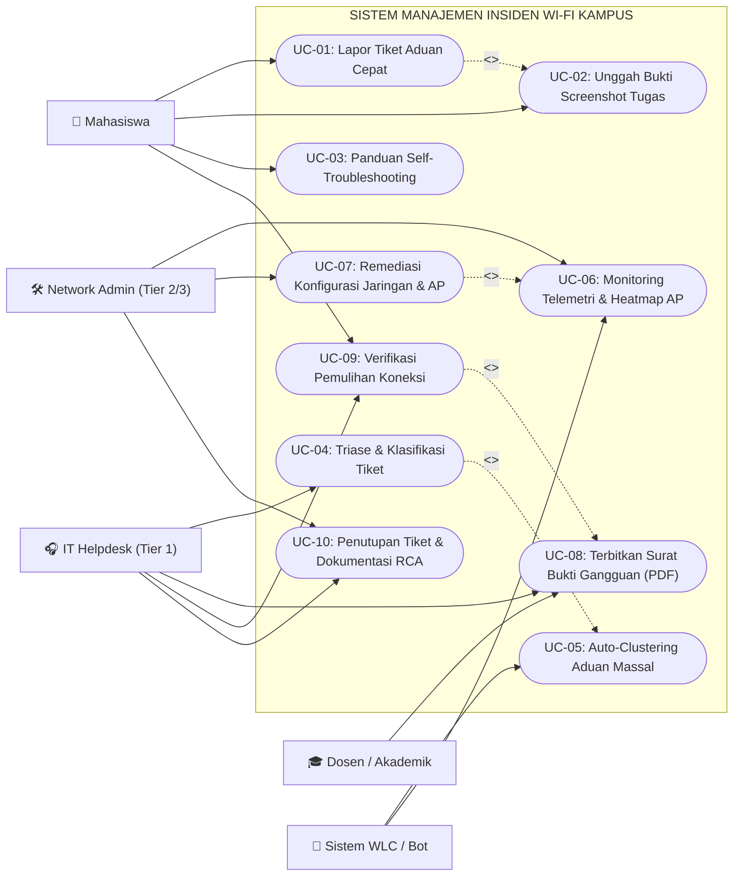
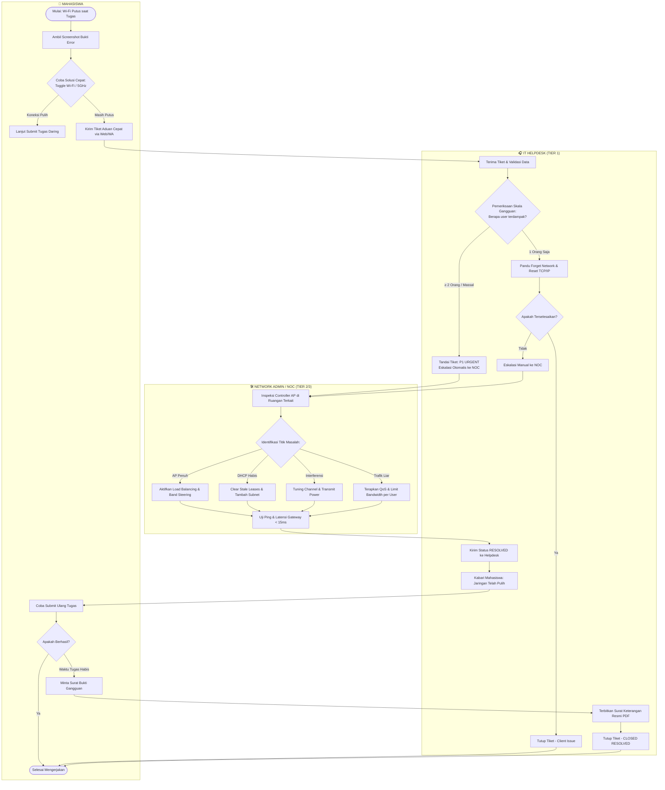
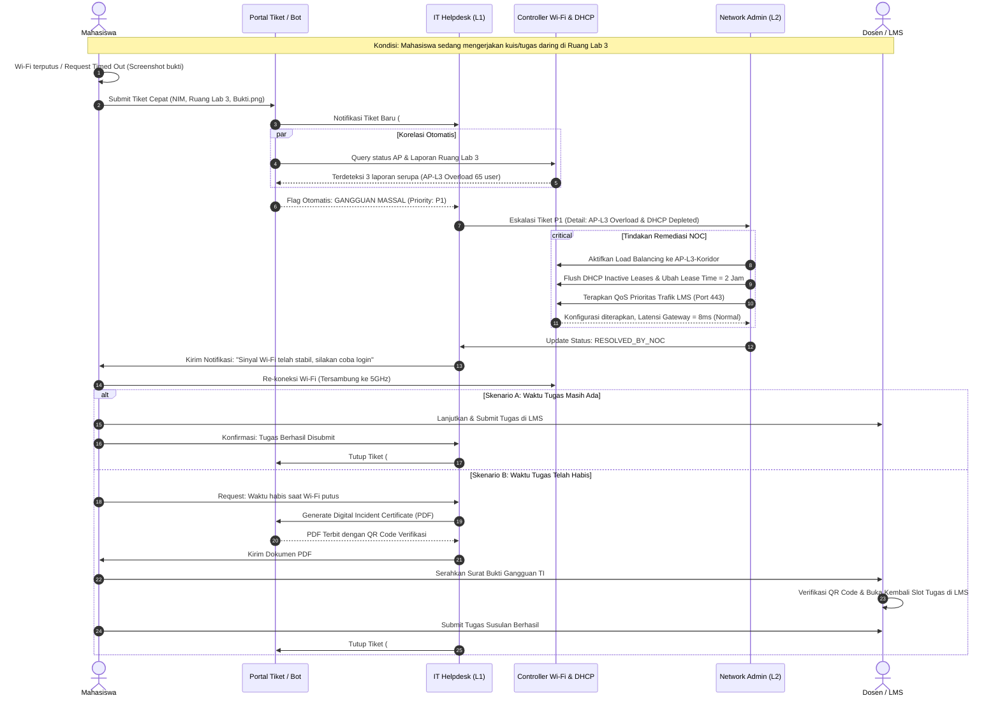
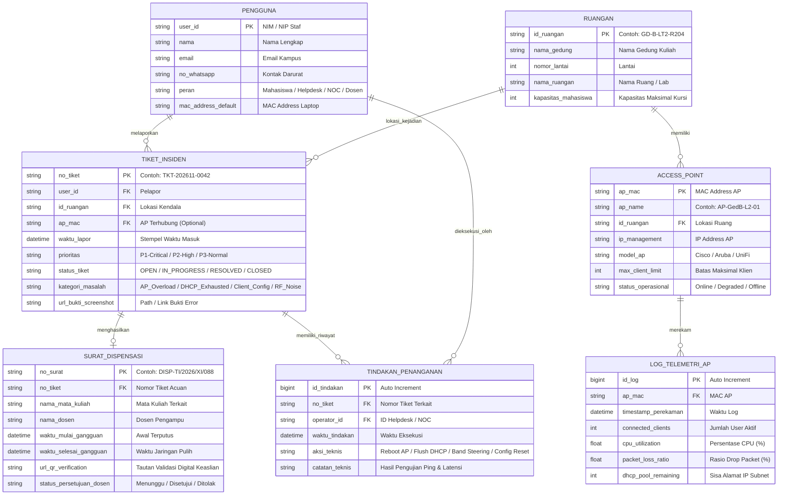

# DOKUMEN PEMODELAN SISTEM (UML & BPMN)
## Kasus: Penanganan Gangguan Wi-Fi Tidak Stabil / Terputus saat Mahasiswa Mengerjakan Tugas Daring

---

## 1. PENDAHULUAN
Dokumen ini menyajikan perancangan dan pemodelan sistem terstruktur untuk merealisasikan alur kerja (*workflow*) dan kebutuhan fungsional (FR-01 s/d FR-08) yang telah disusun pada dokumen spesifikasi sebelumnya.

Pemodelan ini mencakup:
1. **Identifikasi & Matriks Aktor Sistem**
2. **Use Case Diagram & Spesifikasi Use Case Inti**
3. **Activity Diagram (BPMN Swimlane) Lintas Aktor**
4. **Sequence Diagram (Interaksi Pesan Real-Time saat Gangguan Terjadi)**
5. **Entity Relationship Diagram (ERD) & Struktur Database**

---

## 2. IDENTIFIKASI & MATRIKS AKTOR SISTEM

Sistem penanganan insiden ini melibatkan **4 aktor manusia** dan **1 aktor sistem otomatis**:

| Aktor | Tipe Aktor | Deskripsi & Tanggung Jawab Utama |
| :--- | :--- | :--- |
| **Mahasiswa** | *Primary Actor (User)* | Mengalami gangguan koneksi, melakukan pemeriksaan mandiri, mengirim tiket aduan darurat, mengunggah screenshot bukti kendala, dan memverifikasi koneksi. |
| **IT Helpdesk (Tier 1)** | *Internal Actor* | Menerima tiket masuk, memverifikasi data pelapor, melakukan triase klasifikasi gangguan (klien vs jaringan), memberikan panduan setting perangkat, dan mengeksekusi eskalasi. |
| **Network Admin / NOC (Tier 2/3)** | *Technical Actor* | Menerima tiket eskalasi prioritas tinggi, menganalisis controller Wi-Fi (WLC), mengoptimasi daya radio AP, mengelola DHCP pool, mengatur QoS, dan melakukan uji latensi gateway. |
| **Dosen / Bagian Akademik** | *Secondary Actor* | Menerima tembusan surat bukti kendala resmi (digital incident certificate) dan memberikan dispensasi perpanjangan batas waktu submit tugas di LMS. |
| **Sistem Otomatis (WLC / Daemon Bot)** | *Automated System Actor* | Memantau telemetri beban AP, mendeteksi korelasi aduan massal (*auto-clustering*), mengirim alert IP DHCP kritis, dan memicu notifikasi peringatan masa sesi login SSO. |

---

## 3. USE CASE DIAGRAM

### A. Diagram Use Case (Mermaid)

---

### B. Spesifikasi Use Case Terperinci (Use Case Specification)

#### **1. Skenario UC-01: Lapor Tiket Aduan Cepat (Emergency Reporting)**
* **Aktor Utama**: Mahasiswa
* **Pemicu**: Akses Wi-Fi terputus di tengah pengerjaan tugas atau kuis daring.
* **Kondisi Awal (Pre-condition)**: Mahasiswa membuka portal pelaporan helpdesk (atau bot WhatsApp darurat).
* **Alur Utama (Main Flow)**:
  1. Mahasiswa memilih opsi *"Laporkan Gangguan Saat Ujian/Tugas Daring"*.
  2. Sistem menampilkan formulir ringkas: input NIM, pilihan dropdown lokasi (Gedung, Lantai, Nomor Ruang), dan deskripsi gejala.
  3. Mahasiswa melampirkan tangkapan layar (*screenshot*) error tugas.
  4. Mahasiswa menekan tombol *"Kirim Laporan Darurat"*.
  5. Sistem men-generate ID Tiket unik (contoh: `#TKT-WIFI-202611-042`) dan mengirim konfirmasi ke nomor kontak mahasiswa.
* **Kondisi Akhir (Post-condition)**: Tiket tersimpan di database dengan status `OPEN - PENDING TRIASE`.

---

#### **2. Skenario UC-04: Triase & Klasifikasi Tiket (Incident Triaging)**
* **Aktor Utama**: IT Helpdesk (Tier 1) didukung Sistem Otomatis (UC-05)
* **Kondisi Awal**: Tiket baru masuk ke dashboard Helpdesk.
* **Alur Utama (Main Flow)**:
  1. Helpdesk membuka detail tiket dan memverifikasi lokasi ruang mahasiswa.
  2. Sistem secara otomatis mencocokkan laporan lain:
     * *Jalur Kasus Klien*: Jika tidak ada laporan lain dari ruangan tersebut, helpdesk mengirim panduan perbaikan perangkat (re-autentikasi WPA2/Enterprise, flush DNS, reset adapter).
     * *Jalur Kasus Jaringan (Massal)*: Jika sistem mendeteksi ≥ 2 laporan dalam ruangan yang sama, tiket otomatis dinaikkan ke prioritas **P1 - CRITICAL**.
  3. Helpdesk mengeksekusi tombol *"Eskalasi ke Network NOC"* dengan melampirkan identitas Access Point terdekat.
* **Kondisi Akhir**: Tiket diperbarui menjadi status `ESCALATED_TO_NOC`.

---

#### **3. Skenario UC-07: Remediasi Konfigurasi Jaringan & AP**
* **Aktor Utama**: Network Admin / NOC Tier 2
* **Kondisi Awal**: Network Admin menerima notifikasi eskalasi tiket P1.
* **Alur Utama (Main Flow)**:
  1. Admin membuka dashboard WLC pada AP di ruang terdampak.
  2. Mengidentifikasi metrik bottleneck:
     * Kasus AP Overload $\to$ Eksekusi *dynamic client steering* ke AP koridor.
     * Kasus DHCP Exhaustion $\to$ Eksekusi pelepasan IP *inactive lease* & perluas pool.
     * Kasus Interferensi Radio $\to$ Tuning channel non-overlapping (1, 6, 11) dan daya transmisi (*Tx Power*).
     * Kasus Bandwidth Abuse $\to$ Terapkan limit QoS per-user maks. 5 Mbps.
  3. Admin menjalankan uji *ping loop* dan *latency test* ke gateway (< 15 ms).
  4. Admin menandai status tiket menjadi `RESOLVED_BY_NOC`.
* **Kondisi Akhir**: AP beroperasi normal, notifikasi penyelesaian terkirim ke Helpdesk.

---

#### **4. Skenario UC-08: Terbitkan Surat Bukti Gangguan (Digital Incident Certificate)**
* **Aktor Utama**: IT Helpdesk, Mahasiswa, dan Dosen Pengampu
* **Kondisi Awal**: Deadline submit tugas daring terlewat akibat durasi perbaikan jaringan.
* **Alur Utama (Main Flow)**:
  1. Mahasiswa mengajukan permintaan surat bukti pada tiket yang bersangkutan.
  2. Helpdesk memverifikasi log bahwa insiden terkonfirmasi terjadi pada jam pengerjaan tugas.
  3. Helpdesk menekan tombol *"Generate Surat Keterangan Gangguan TI"*.
  4. Sistem menghasilkan dokumen PDF resmi berisi: ID Tiket, Nama & NIM, Lokasi, Waktu mulai hingga waktu pulih, dan QR Code verifikasi keaslian.
  5. Dokumen diunduh oleh mahasiswa dan ditembuskan ke email Dosen Pengampu untuk membuka kembali akses pengumpulan tugas di LMS.
* **Kondisi Akhir**: Surat resmi tersimpan di database dan hak akademik mahasiswa terlindungi.

---

## 4. ACTIVITY DIAGRAM (BPMN SWIMLANE)

Diagram alur lintas entitas (Swimlane) yang menggambarkan proses bisnis secara menyeluruh dari awal insiden hingga resolusi:

---

## 5. SEQUENCE DIAGRAM (INTERAKSI WAKTU-NYATA)

Diagram sekuensial yang merepresentasikan pertukaran pesan secara kronologis antar-komponen saat terjadi kegagalan transmisi data:

---

## 6. ENTITY RELATIONSHIP DIAGRAM (ERD) & STRUKTUR BASIS DATA

Berikut adalah rancangan basis data relasional untuk mengelola entitas pengguna, inventaris ruangan, perangkat *Access Point*, log tiket, dan sertifikat dispensasi akademik:

### A. Diagram Relasi Entitas (Mermaid ERD)

---

### B. Kamus Data & Normalisasi Tabel

1. **Integritas Relasi**:
   * Setiap `TIKET_INSIDEN` wajib mengacu pada 1 `PENGGUNA` (pelapor) dan 1 `RUANGAN`.
   * Satu `RUANGAN` dapat memiliki 1 atau lebih unit `ACCESS_POINT`.
   * Tabel `LOG_TELEMETRI_AP` dipartisi berdasarkan stempel waktu (*time-series data*) untuk mendukung analisis audit historis (NFR-08).
   * Tabel `SURAT_DISPENSASI` berelasi *one-to-one* dengan `TIKET_INSIDEN` yang berprioritas P1 untuk memastikan tidak ada duplikasi surat untuk insiden yang sama.

2. **Indeks Performa (Database Indexing)**:
   * Indeks komposit pada `TIKET_INSIDEN (id_ruangan, waktu_lapor)` untuk mempercepat algoritma *Auto-Clustering* (FR-02) dalam waktu respon < 100 ms.
   * Indeks pada `LOG_TELEMETRI_AP (ap_mac, timestamp_perekaman)` guna mendukung visualisasi *Heatmap Real-Time* (FR-03).

---
*Dokumen pemodelan sistem ini melengkapi spesifikasi fungsional & non-fungsional sebagai acuan implementasi kode dan penyusunan laporan proyek.*
